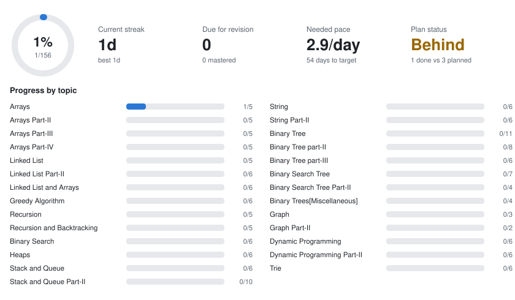

# Striver's SDE Sheet in Python

**[Open the live dashboard ->](https://ysdesai.github.io/striver-sde-sheet/)** - check off problems, rate them, take notes, and see what's due for revision today.

     

<picture><source media="(prefers-color-scheme: dark)" srcset="assets/stats-dark.svg"></picture>

<picture><source media="(prefers-color-scheme: dark)" srcset="assets/heatmap-dark.svg"></picture>

Auto-generated by `scripts/build_readme.py`. Don't edit this file by hand; edit progress from the dashboard.

**Legend:** ✅ solved · 🔁 due for revision · ⭐ mastered (cleared all 5 revisions) · 🟦 basic · 🟨 core · 🟥 pro (Striver's levels) · E/M/H LeetCode difficulty · `≈` LeetCode equivalent of a non-LeetCode problem · 💲 LeetCode Premium

<b>Arrays</b> - 2/5

| # | Problem | Practice | Learn | Lvl | Status | Next review | Code |
|---|---|---|---|---|---|---|---|
| 1 | Set Matrix Zeroes | [LC 73](https://leetcode.com/problems/set-matrix-zeroes/) M · [TUF](https://takeuforward.org/practice/dsa/set-matrix-zeroes?source=strivers-sde-sheet) | [▶ video](https://youtu.be/N0MgLvceX7M) · [article](https://takeuforward.org/blogs/data-structure-and-algorithm/set-matrix-zeroes) | 🟨 | ✅ | 2026-10-29 |  |
| 2 | Pascal's Triangle I | [LC 118](https://leetcode.com/problems/pascals-triangle/) E · [TUF](https://takeuforward.org/practice/dsa/pascals-triangle-i?source=strivers-sde-sheet) | [▶ video](https://youtu.be/bR7mQgwQ_o8) · [article](https://takeuforward.org/blogs/data-structure-and-algorithm/pascals-triangle-first-n-rows) | 🟨 | ✅ | 2026-10-29 |  |
| 3 | Next Permutation | [LC 31](https://leetcode.com/problems/next-permutation/) M · [TUF](https://takeuforward.org/practice/dsa/next-permutation?source=strivers-sde-sheet) | [▶ video](https://youtu.be/JDOXKqF60RQ) · [article](https://takeuforward.org/blogs/data-structure-and-algorithm/next-permutation) | 🟨 |  |  |  |
| 4 | Kadane's Algorithm | [LC 53](https://leetcode.com/problems/maximum-subarray/) M · [TUF](https://takeuforward.org/practice/dsa/kadane%27s-algorithm?source=strivers-sde-sheet) | [▶ video](https://youtu.be/AHZpyENo7k4) | 🟨 |  |  |  |
| 5 | Sort an array of 0's 1's and 2's | [LC 75](https://leetcode.com/problems/sort-colors/) M · [TUF](https://takeuforward.org/practice/dsa/sort-an-array-of-0%27s-1%27s-and-2%27s?source=strivers-sde-sheet) | [▶ video](https://youtu.be/tp8JIuCXBaU) · [article](https://takeuforward.org/blogs/data-structure-and-algorithm/sort-array-0s-1s-2s) | 🟨 |  |  |  |

<b>Arrays Part-II</b> - 0/5

| # | Problem | Practice | Learn | Lvl | Status | Next review | Code |
|---|---|---|---|---|---|---|---|
| 6 | Rotate matrix by 90 degrees | [LC 48](https://leetcode.com/problems/rotate-image/) M · [TUF](https://takeuforward.org/practice/dsa/rotate-matrix-by-90-degrees?source=strivers-sde-sheet) | [▶ video](https://youtu.be/Z0R2u6gd3GU) · [article](https://takeuforward.org/blogs/data-structure-and-algorithm/rotate-matrix-90-degrees-clockwise) | 🟨 |  |  |  |
| 7 | Merge Overlapping Subintervals | [LC 56](https://leetcode.com/problems/merge-intervals/) M · [TUF](https://takeuforward.org/practice/dsa/merge-overlapping-subintervals?source=strivers-sde-sheet) | [▶ video](https://youtu.be/IexN60k62jo) · [article](https://takeuforward.org/blogs/data-structure-and-algorithm/merge-overlapping-intervals) | 🟨 |  |  |  |
| 8 | Merge two sorted arrays without extra space | [LC 88](https://leetcode.com/problems/merge-sorted-array/) E · [TUF](https://takeuforward.org/practice/dsa/merge-two-sorted-arrays-without-extra-space?source=strivers-sde-sheet) | [▶ video](https://youtu.be/n7uwj04E0I4) | 🟨 |  |  |  |
| 9 | Find the Duplicate Number | [LC 287](https://leetcode.com/problems/find-the-duplicate-number/) M · [TUF](https://takeuforward.org/practice/dsa/find-the-duplicate-number?source=strivers-sde-sheet) | [▶ video](https://www.youtube.com/watch?v=32Ll35mhWg0&list=PLgUwDviBIf0rPG3Ictpu74YWBQ1CaBkm2&index=1) | 🟨 |  |  |  |
| 10 | Find the repeating and missing number | [≈ LC 2965](https://leetcode.com/problems/find-missing-and-repeated-values/) E · [TUF](https://takeuforward.org/practice/dsa/find-the-repeating-and-missing-number?source=strivers-sde-sheet) | [▶ video](https://youtu.be/2D0D8HE6uak) · [article](https://takeuforward.org/blogs/data-structure-and-algorithm/find-the-missing-and-repeating-numbers-in-an-array) | 🟨 |  |  |  |

<b>Arrays Part-III</b> - 0/5

| # | Problem | Practice | Learn | Lvl | Status | Next review | Code |
|---|---|---|---|---|---|---|---|
| 11 | Search in a 2D Matrix | [LC 74](https://leetcode.com/problems/search-a-2d-matrix/) M · [TUF](https://takeuforward.org/practice/dsa/search-in-a-2d-matrix?source=strivers-sde-sheet) | [▶ video](https://youtu.be/ZYpYur0znng) · [article](https://takeuforward.org/blogs/data-structure-and-algorithm/search-in-sorted-2d-matrix) | 🟨 |  |  |  |
| 12 | Majority Element-I | [LC 169](https://leetcode.com/problems/majority-element/) E · [TUF](https://takeuforward.org/practice/dsa/majority-element-i?source=strivers-sde-sheet) | [▶ video](https://youtu.be/nP_ns3uSh80) · [article](https://takeuforward.org/blogs/data-structure-and-algorithm/majority-element-n-by-2) | 🟨 |  |  |  |
| 13 | Majority Element-II | [LC 229](https://leetcode.com/problems/majority-element-ii/) M · [TUF](https://takeuforward.org/practice/dsa/majority-element-ii?source=strivers-sde-sheet) | [▶ video](https://youtu.be/vwZj1K0e9U8) · [article](https://takeuforward.org/blogs/data-structure-and-algorithm/majority-element-ii-n-by-3) | 🟨 |  |  |  |
| 14 | Grid unique paths | [LC 62](https://leetcode.com/problems/unique-paths/) M · [TUF](https://takeuforward.org/practice/dsa/grid-unique-paths?source=strivers-sde-sheet) | [▶ video](https://www.youtube.com/watch?v=sdE0A2Oxofw) · [article](https://takeuforward.org/blogs/data-structure-and-algorithm/grid-unique-paths) | 🟨 |  |  |  |
| 15 | Reverse Pairs | [LC 493](https://leetcode.com/problems/reverse-pairs/) H · [TUF](https://takeuforward.org/practice/dsa/reverse-pairs?source=strivers-sde-sheet) | [▶ video](https://youtu.be/0e4bZaP3MDI) · [article](https://takeuforward.org/blogs/data-structure-and-algorithm/count-reverse-pairs) | 🟥 |  |  |  |

<b>Arrays Part-IV</b> - 0/5

| # | Problem | Practice | Learn | Lvl | Status | Next review | Code |
|---|---|---|---|---|---|---|---|
| 16 | Two Sum | [LC 1](https://leetcode.com/problems/two-sum/) E · [TUF](https://takeuforward.org/practice/dsa/two-sum?source=strivers-sde-sheet) | [▶ video](https://youtu.be/UXDSeD9mN-k) · [article](https://takeuforward.org/blogs/data-structure-and-algorithm/two-sum) | 🟦 |  |  |  |
| 17 | 4 Sum | [LC 18](https://leetcode.com/problems/4sum/) M · [TUF](https://takeuforward.org/practice/dsa/4-sum?source=strivers-sde-sheet) | [▶ video](https://youtu.be/eD95WRfh81c) · [article](https://takeuforward.org/blogs/data-structure-and-algorithm/4sum) | 🟥 |  |  |  |
| 18 | Longest Consecutive Sequence in an Array | [LC 128](https://leetcode.com/problems/longest-consecutive-sequence/) M · [TUF](https://takeuforward.org/practice/dsa/longest-consecutive-sequence-in-an-array?source=strivers-sde-sheet) | [▶ video](https://youtu.be/oO5uLE7EUlM) · [article](https://takeuforward.org/blogs/data-structure-and-algorithm/longest-consecutive-sequence-in-an-array) | 🟨 |  |  |  |
| 19 | Count subarrays with given xor K | [TUF](https://takeuforward.org/practice/dsa/count-subarrays-with-given-xor-k?source=strivers-sde-sheet) | [▶ video](https://youtu.be/eZr-6p0B7ME) · [article](https://takeuforward.org/blogs/data-structure-and-algorithm/count-subarrays-with-a-given-xor-k) | 🟥 |  |  |  |
| 20 | Longest Substring Without Repeating Characters | [LC 3](https://leetcode.com/problems/longest-substring-without-repeating-characters/) M · [TUF](https://takeuforward.org/practice/dsa/longest-substring-without-repeating-characters?source=strivers-sde-sheet) | [▶ video](https://youtu.be/-zSxTJkcdAo?si=I2zfR-vlDMg0zU9z) · [article](https://takeuforward.org/blogs/data-structure-and-algorithm/longest-substring-without-repeating-characters) | 🟨 |  |  |  |

<b>Linked List</b> - 0/5

| # | Problem | Practice | Learn | Lvl | Status | Next review | Code |
|---|---|---|---|---|---|---|---|
| 21 | Reverse a LL | [LC 206](https://leetcode.com/problems/reverse-linked-list/) E · [TUF](https://takeuforward.org/practice/dsa/reverse-a-ll?source=strivers-sde-sheet) | [▶ video](https://youtu.be/D2vI2DNJGd8?si=RCaLSx01qR21IBdh) · [article](https://takeuforward.org/blogs/data-structure-and-algorithm/reverse-a-singly-linked-list) | 🟨 |  |  |  |
| 22 | Find Middle of Linked List | [LC 876](https://leetcode.com/problems/middle-of-the-linked-list/) E · [TUF](https://takeuforward.org/practice/dsa/find-middle-of-linked-list?source=strivers-sde-sheet) | [▶ video](https://youtu.be/7LjQ57RqgEc?si=ir_rRDio38rhamU_) · [article](https://takeuforward.org/blogs/data-structure-and-algorithm/find-middle-of-linked-list) | 🟦 |  |  |  |
| 23 | Merge two Sorted Lists  | [LC 21](https://leetcode.com/problems/merge-two-sorted-lists/) E · [TUF](https://takeuforward.org/practice/dsa/merge-sorted-lists-?source=strivers-sde-sheet) | [▶ video](https://www.youtube.com/watch?v=Xb4slcp1U38&list=PLgUwDviBIf0p4ozDR_kJJkONnb1wdx2Ma&index=29) · [article](https://takeuforward.org/blogs/data-structure-and-algorithm/merge-two-sorted-linked-lists) | 🟦 |  |  |  |
| 24 | Remove Nth node from the back of the LL | [LC 19](https://leetcode.com/problems/remove-nth-node-from-end-of-list/) M · [TUF](https://takeuforward.org/practice/dsa/remove-nth-node-from-the-back-of-the-ll?source=strivers-sde-sheet) | [▶ video](https://youtu.be/3kMKYQ2wNIU?si=DtFDnPU7z9HMz_GM) · [article](https://takeuforward.org/blogs/data-structure-and-algorithm/remove-the-nth-node-from-the-end-of-a-linked-list) | 🟨 |  |  |  |
| 25 | Delete Node in a Linked List O(1) | [LC 237](https://leetcode.com/problems/delete-node-in-a-linked-list/) M · [TUF](https://takeuforward.org/practice/dsa/delete-node-in-a-linked-list-o1?source=strivers-sde-sheet) | [▶ video](https://www.youtube.com/watch?v=icnp4FJdZ_c&list=PLgUwDviBIf0p4ozDR_kJJkONnb1wdx2Ma&index=31) | 🟨 |  |  |  |

<b>Linked List Part-II</b> - 0/6

| # | Problem | Practice | Learn | Lvl | Status | Next review | Code |
|---|---|---|---|---|---|---|---|
| 26 | Find the intersection point of Y LL | [LC 160](https://leetcode.com/problems/intersection-of-two-linked-lists/) E · [TUF](https://takeuforward.org/practice/dsa/find-the-intersection-point-of-y-ll?source=strivers-sde-sheet) | [▶ video](https://youtu.be/0DYoPz2Tpt4?si=L-uJs5yXUxj4VJM2) · [article](https://takeuforward.org/blogs/data-structure-and-algorithm/intersection-of-two-linked-lists) | 🟨 |  |  |  |
| 27 | Detect a loop in LL | [LC 141](https://leetcode.com/problems/linked-list-cycle/) E · [TUF](https://takeuforward.org/practice/dsa/detect-a-loop-in-ll?source=strivers-sde-sheet) | [▶ video](https://youtu.be/wiOo4DC5GGA?si=zagt6O6tFXc4_3cx) · [article](https://takeuforward.org/blogs/data-structure-and-algorithm/detect-cycle-linked-list) | 🟨 |  |  |  |
| 28 | Reverse LL in group of given size K | [LC 25](https://leetcode.com/problems/reverse-nodes-in-k-group/) H · [TUF](https://takeuforward.org/practice/dsa/reverse-ll-in-group-of-given-size-k?source=strivers-sde-sheet) | [▶ video](https://youtu.be/lIar1skcQYI?si=_jFghHKX4eaK36a1) · [article](https://takeuforward.org/blogs/data-structure-and-algorithm/reverse-linked-list-k-groups) | 🟥 |  |  |  |
| 29 | Check if LL is palindrome or not | [LC 234](https://leetcode.com/problems/palindrome-linked-list/) E · [TUF](https://takeuforward.org/practice/dsa/check-if-ll-is-palindrome-or-not?source=strivers-sde-sheet) | [▶ video](https://youtu.be/lRY_G-u_8jk?si=BpM8hRYvXSYyjl-G) · [article](https://takeuforward.org/blogs/data-structure-and-algorithm/check-if-a-linked-list-is-a-palindrome) | 🟨 |  |  |  |
| 30 | Find the starting point in LL | [LC 142](https://leetcode.com/problems/linked-list-cycle-ii/) M · [TUF](https://takeuforward.org/practice/dsa/find-the-starting-point-in-ll?source=strivers-sde-sheet) | [▶ video](https://youtu.be/2Kd0KKmmHFc?si=7UreDPRjRvapeVB0) · [article](https://takeuforward.org/blogs/data-structure-and-algorithm/find-start-of-cycle-linked-list) | 🟨 |  |  |  |
| 31 | Flattening of LL | [LC 23](https://leetcode.com/problems/merge-k-sorted-lists/) H · [TUF](https://takeuforward.org/practice/dsa/flattening-of-ll?source=strivers-sde-sheet) | [▶ video](https://youtu.be/ykelywHJWLg?si=InMg9MmTHzY22NSR) · [article](https://takeuforward.org/blogs/data-structure-and-algorithm/flatten-linked-list) | 🟥 |  |  |  |

<b>Linked List and Arrays</b> - 0/6

| # | Problem | Practice | Learn | Lvl | Status | Next review | Code |
|---|---|---|---|---|---|---|---|
| 32 | Rotate a LL | [LC 61](https://leetcode.com/problems/rotate-list/) M · [TUF](https://takeuforward.org/practice/dsa/rotate-a-ll?source=strivers-sde-sheet) | [▶ video](https://youtu.be/uT7YI7XbTY8?si=ZaChW3a68c_v54Is) · [article](https://takeuforward.org/blogs/data-structure-and-algorithm/rotate-linked-list-right-k-places) | 🟨 |  |  |  |
| 33 | Clone a LL with random and next pointer | [LC 138](https://leetcode.com/problems/copy-list-with-random-pointer/) M · [TUF](https://takeuforward.org/practice/dsa/clone-a-ll-with-random-and-next-pointer?source=strivers-sde-sheet) | [▶ video](https://youtu.be/q570bKdrnlw?si=epZtpWvtNwuTf23o) · [article](https://takeuforward.org/blogs/data-structure-and-algorithm/clone-linked-list-random-pointer) | 🟥 |  |  |  |
| 34 | 3 Sum | [LC 15](https://leetcode.com/problems/3sum/) M · [TUF](https://takeuforward.org/practice/dsa/3-sum?source=strivers-sde-sheet) | [▶ video](https://youtu.be/DhFh8Kw7ymk) · [article](https://takeuforward.org/blogs/data-structure-and-algorithm/3sum) | 🟨 |  |  |  |
| 35 | Trapping Rainwater | [LC 42](https://leetcode.com/problems/trapping-rain-water/) H · [TUF](https://takeuforward.org/practice/dsa/trapping-rainwater?source=strivers-sde-sheet) | [▶ video](https://youtu.be/1_5VuquLbXg?si=NFG6df318_6OtGvg) · [article](https://takeuforward.org/blogs/data-structure-and-algorithm/trapping-rain-water) | 🟥 |  |  |  |
| 36 | Remove duplicates from sorted array | [LC 26](https://leetcode.com/problems/remove-duplicates-from-sorted-array/) E · [TUF](https://takeuforward.org/practice/dsa/remove-duplicates-from-sorted-array?source=strivers-sde-sheet) | [▶ video](https://youtu.be/37E9ckMDdTk?t=1887) · [article](https://takeuforward.org/blogs/data-structure-and-algorithm/remove-duplicates-from-a-sorted-array-in-place) | 🟦 |  |  |  |
| 37 | Maximum Consecutive Ones | [LC 485](https://leetcode.com/problems/max-consecutive-ones/) E · [TUF](https://takeuforward.org/practice/dsa/maximum-consecutive-ones?source=strivers-sde-sheet) | [▶ video](https://youtu.be/bYWLJb3vCWY?t=1124) · [article](https://takeuforward.org/blogs/data-structure-and-algorithm/maximum-consecutive-ones-in-a-binary-array) | 🟦 |  |  |  |

<b>Greedy Algorithm</b> - 0/6

| # | Problem | Practice | Learn | Lvl | Status | Next review | Code |
|---|---|---|---|---|---|---|---|
| 38 | N meetings in one room | [TUF](https://takeuforward.org/practice/dsa/n-meetings-in-one-room?source=strivers-sde-sheet) | [▶ video](https://youtu.be/mKfhTotEguk?si=2RELeq18mpmIIN3Q) · [article](https://takeuforward.org/blogs/data-structure-and-algorithm/n-meetings-in-one-room) | 🟨 |  |  |  |
| 39 | Minimum number of platforms required for a railway | [LC 2406](https://leetcode.com/problems/divide-intervals-into-minimum-number-of-groups/) M · [TUF](https://takeuforward.org/practice/dsa/minimum-number-of-platforms-required-for-a-railway?source=strivers-sde-sheet) | [▶ video](https://youtu.be/AsGzwR_FWok?si=165acXU_dtqOHuo9) · [article](https://takeuforward.org/blogs/data-structure-and-algorithm/minimum-platforms-required-for-a-railway-station) | 🟨 |  |  |  |
| 40 | Job sequencing Problem | [TUF](https://takeuforward.org/practice/dsa/job-sequencing-problem?source=strivers-sde-sheet) | [▶ video](https://youtu.be/QbwltemZbRg?si=wvcemJ5BLPlTRmkG) · [article](https://takeuforward.org/blogs/data-structure-and-algorithm/job-sequencing-problem) | 🟨 |  |  |  |
| 41 | Fractional Knapsack | [TUF](https://takeuforward.org/practice/dsa/fractional-knapsack?source=strivers-sde-sheet) | [▶ video](https://youtu.be/1ibsQrnuEEg?si=8R2By3wpHo0zZVHE) | 🟨 |  |  |  |
| 42 | Minimum coins | [LC 322](https://leetcode.com/problems/coin-change/) M · [TUF](https://takeuforward.org/practice/dsa/minimum-coins?source=strivers-sde-sheet) | [▶ video](https://www.youtube.com/watch?v=myPeWb3Y68A) | 🟨 |  |  |  |
| 43 | Assign Cookies | [LC 455](https://leetcode.com/problems/assign-cookies/) E · [TUF](https://takeuforward.org/practice/dsa/assign-cookies?source=strivers-sde-sheet) | [▶ video](https://youtu.be/DIX2p7vb9co?si=GofAIDimue-Av0Fi) · [article](https://takeuforward.org/blogs/data-structure-and-algorithm/assign-cookies) | 🟨 |  |  |  |

<b>Recursion</b> - 0/5

| # | Problem | Practice | Learn | Lvl | Status | Next review | Code |
|---|---|---|---|---|---|---|---|
| 44 | Subsets II | [LC 90](https://leetcode.com/problems/subsets-ii/) M · [TUF](https://takeuforward.org/practice/dsa/subsets-ii?source=strivers-sde-sheet) | [▶ video](https://www.youtube.com/watch?v=RIn3gOkbhQE&list=PLgUwDviBIf0p4ozDR_kJJkONnb1wdx2Ma&index=53) | 🟨 |  |  |  |
| 45 | Combination Sum | [LC 39](https://leetcode.com/problems/combination-sum/) M · [TUF](https://takeuforward.org/practice/dsa/combination-sum?source=strivers-sde-sheet) | [▶ video](https://www.youtube.com/watch?v=OyZFFqQtu98&list=PLgUwDviBIf0p4ozDR_kJJkONnb1wdx2Ma&index=49) | 🟨 |  |  |  |
| 46 | Combination Sum II | [LC 40](https://leetcode.com/problems/combination-sum-ii/) M · [TUF](https://takeuforward.org/practice/dsa/combination-sum-ii?source=strivers-sde-sheet) | [▶ video](https://www.youtube.com/watch?v=G1fRTGRxXU8&list=PLgUwDviBIf0p4ozDR_kJJkONnb1wdx2Ma&index=50) | 🟨 |  |  |  |
| 47 | Palindrome partitioning | [LC 131](https://leetcode.com/problems/palindrome-partitioning/) M · [TUF](https://takeuforward.org/practice/dsa/palindrome-partitioning?source=strivers-sde-sheet) | [▶ video](https://youtu.be/_H8V5hJUGd0) | 🟥 |  |  |  |
| 48 | Permutation Sequence | [LC 60](https://leetcode.com/problems/permutation-sequence/) H · [TUF](https://takeuforward.org/practice/dsa/permutation-sequence?source=strivers-sde-sheet) | [▶ video](https://www.youtube.com/watch?v=wT7gcXLYoao&list=PLgUwDviBIf0p4ozDR_kJJkONnb1wdx2Ma&index=55) | 🟥 |  |  |  |

<b>Recursion and Backtracking</b> - 0/5

| # | Problem | Practice | Learn | Lvl | Status | Next review | Code |
|---|---|---|---|---|---|---|---|
| 49 | Permutations of a String | [LC 47](https://leetcode.com/problems/permutations-ii/) M · [TUF](https://takeuforward.org/practice/dsa/permutations-of-a-string?source=strivers-sde-sheet) | [▶ video](https://www.youtube.com/watch?v=f2ic2Rsc9pU&list=PLgUwDviBIf0p4ozDR_kJJkONnb1wdx2Ma&index=52) | 🟨 |  |  |  |
| 50 | N Queen | [LC 51](https://leetcode.com/problems/n-queens/) H · [TUF](https://takeuforward.org/practice/dsa/n-queen?source=strivers-sde-sheet) | [▶ video](https://www.youtube.com/watch?v=i05Ju7AftcM&list=PLgUwDviBIf0p4ozDR_kJJkONnb1wdx2Ma&index=57) | 🟥 |  |  |  |
| 51 | Sudoku Solver | [LC 37](https://leetcode.com/problems/sudoku-solver/) H · [TUF](https://takeuforward.org/practice/dsa/sudoko-solver?source=strivers-sde-sheet) | [▶ video](https://www.youtube.com/watch?v=FWAIf_EVUKE&list=PLgUwDviBIf0p4ozDR_kJJkONnb1wdx2Ma&index=58) | 🟥 |  |  |  |
| 52 | M Coloring Problem | [TUF](https://takeuforward.org/practice/dsa/m-coloring-problem?source=strivers-sde-sheet) | [▶ video](https://www.youtube.com/watch?v=wuVwUK25Rfc&list=PLgUwDviBIf0p4ozDR_kJJkONnb1wdx2Ma&index=59) | 🟥 |  |  |  |
| 53 | Rat in a Maze | [TUF](https://takeuforward.org/practice/dsa/rat-in-a-maze?source=strivers-sde-sheet) | [▶ video](https://www.youtube.com/watch?v=bLGZhJlt4y0&list=PLgUwDviBIf0p4ozDR_kJJkONnb1wdx2Ma&index=60) | 🟥 |  |  |  |

<b>Binary Search</b> - 0/6

| # | Problem | Practice | Learn | Lvl | Status | Next review | Code |
|---|---|---|---|---|---|---|---|
| 54 | Matrix Median | [LC 2387](https://leetcode.com/problems/median-of-a-row-wise-sorted-matrix/) 💲 M · [TUF](https://takeuforward.org/practice/dsa/matrix-median?source=strivers-sde-sheet) | [▶ video](https://youtu.be/Q9wXgdxJq48?si=ScI_0uzJh7yg8nrX) · [article](https://takeuforward.org/blogs/data-structure-and-algorithm/median-of-a-row-wise-sorted-matrix) | 🟥 |  |  |  |
| 55 | Single element in sorted array | [LC 540](https://leetcode.com/problems/single-element-in-a-sorted-array/) M · [TUF](https://takeuforward.org/practice/dsa/single-element-in-sorted-array?source=strivers-sde-sheet) | [▶ video](https://youtu.be/AZOmHuHadxQ) · [article](https://takeuforward.org/blogs/data-structure-and-algorithm/single-element-in-a-sorted-array) | 🟨 |  |  |  |
| 56 | Median of 2 sorted arrays | [LC 4](https://leetcode.com/problems/median-of-two-sorted-arrays/) H · [TUF](https://takeuforward.org/practice/dsa/median-of-2-sorted-arrays?source=strivers-sde-sheet) | [▶ video](https://www.youtube.com/watch?v=NTop3VTjmxk&list=PLgUwDviBIf0p4ozDR_kJJkONnb1wdx2Ma&index=65) · [article](https://takeuforward.org/blogs/data-structure-and-algorithm/median-of-2-sorted-arrays) | 🟥 |  |  |  |
| 57 | Kth element of 2 sorted arrays | [TUF](https://takeuforward.org/practice/dsa/kth-element-of-2-sorted-arrays?source=strivers-sde-sheet) | [▶ video](https://www.youtube.com/watch?v=nv7F4PiLUzo&list=PLgUwDviBIf0p4ozDR_kJJkONnb1wdx2Ma&index=66) · [article](https://takeuforward.org/blogs/data-structure-and-algorithm/kth-element-of-two-sorted-arrays) | 🟥 |  |  |  |
| 58 | Allocate Minimum Number of Pages | [≈ LC 410](https://leetcode.com/problems/split-array-largest-sum/) H · [TUF](https://takeuforward.org/practice/dsa/allocate-minimum-number-of-pages?source=strivers-sde-sheet) | [▶ video](https://www.youtube.com/watch?v=gYmWHvRHu-s&list=PLgUwDviBIf0p4ozDR_kJJkONnb1wdx2Ma&index=69) · [article](https://takeuforward.org/blogs/data-structure-and-algorithm/book-allocation-problem) | 🟥 |  |  |  |
| 59 | Aggressive Cows | [≈ LC 1552](https://leetcode.com/problems/magnetic-force-between-two-balls/) M · [TUF](https://takeuforward.org/practice/dsa/aggressive-cows?source=strivers-sde-sheet) | [▶ video](https://youtu.be/R_Mfw4ew-Vo) · [article](https://takeuforward.org/blogs/data-structure-and-algorithm/aggressive-cows) | 🟥 |  |  |  |

<b>Heaps</b> - 0/6

| # | Problem | Practice | Learn | Lvl | Status | Next review | Code |
|---|---|---|---|---|---|---|---|
| 60 | Implement Max Heap | [TUF](https://takeuforward.org/practice/dsa/implement-max-heap?source=strivers-sde-sheet) |  | 🟨 |  |  |  |
| 61 | K-th Largest element in an array | [LC 215](https://leetcode.com/problems/kth-largest-element-in-an-array/) M · [TUF](https://takeuforward.org/practice/dsa/k-th-largest-element-in-an-array?source=strivers-sde-sheet) | [article](https://takeuforward.org/blogs/data-structure-and-algorithm/k-th-largest-element-in-an-array) | 🟥 |  |  |  |
| 62 | Maximum Sum Combination | [TUF](https://takeuforward.org/practice/dsa/maximum-sum-combination?source=strivers-sde-sheet) |  | 🟨 |  |  |  |
| 63 | Find Median from Data Stream | [LC 295](https://leetcode.com/problems/find-median-from-data-stream/) H · [TUF](https://takeuforward.org/practice/dsa/find-median-from-data-stream?source=strivers-sde-sheet) | [article](https://takeuforward.org/blogs/data-structure-and-algorithm/find-median-data-stream) | 🟥 |  |  |  |
| 64 | Merge K Sorted Arrays | [LC 23](https://leetcode.com/problems/merge-k-sorted-lists/) H · [TUF](https://takeuforward.org/practice/dsa/merge-k-sorted-arrays?source=strivers-sde-sheet) |  | 🟥 |  |  |  |
| 65 | Top K Frequent Elements | [LC 347](https://leetcode.com/problems/top-k-frequent-elements/) M · [TUF](https://takeuforward.org/practice/dsa/top-k-frequent-elements?source=strivers-sde-sheet) | [article](https://takeuforward.org/blogs/data-structure-and-algorithm/top-k-frequent-elements) | 🟨 |  |  |  |

<b>Stack and Queue</b> - 0/6

| # | Problem | Practice | Learn | Lvl | Status | Next review | Code |
|---|---|---|---|---|---|---|---|
| 66 | Implement Stack using Arrays | [TUF](https://takeuforward.org/practice/dsa/implement-stack-using-arrays?source=strivers-sde-sheet) | [▶ video](https://youtu.be/tqQ5fTamIN4?si=ofLt8Zt1ZvhikZ6w) · [article](https://takeuforward.org/blogs/data-structure-and-algorithm/implement-a-stack-using-an-array) | 🟨 |  |  |  |
| 67 | Implement Queue using Arrays | [≈ LC 622](https://leetcode.com/problems/design-circular-queue/) M · [TUF](https://takeuforward.org/practice/dsa/implement-queue-using-arrays?source=strivers-sde-sheet) | [▶ video](https://youtu.be/tqQ5fTamIN4?si=ofLt8Zt1ZvhikZ6w) · [article](https://takeuforward.org/blogs/data-structure-and-algorithm/implement-a-queue-using-an-array) | 🟨 |  |  |  |
| 68 | Implement Queue using Stack | [LC 232](https://leetcode.com/problems/implement-queue-using-stacks/) E · [TUF](https://takeuforward.org/practice/dsa/implement-queue-using-stack?source=strivers-sde-sheet) | [▶ video](https://youtu.be/tqQ5fTamIN4?si=ofLt8Zt1ZvhikZ6w) · [article](https://takeuforward.org/blogs/data-structure-and-algorithm/implement-a-queue-using-stacks) | 🟨 |  |  |  |
| 69 | Balanced Paranthesis | [LC 20](https://leetcode.com/problems/valid-parentheses/) E · [TUF](https://takeuforward.org/practice/dsa/balanced-paranthesis?source=strivers-sde-sheet) | [▶ video](https://youtu.be/xwjS0iZhw4I?si=UoyKpFn4Q3nf5h2R) · [article](https://takeuforward.org/blogs/data-structure-and-algorithm/check-balanced-parentheses-using-a-stack) | 🟨 |  |  |  |
| 70 | Next Greater Element | [LC 496](https://leetcode.com/problems/next-greater-element-i/) E · [TUF](https://takeuforward.org/practice/dsa/next-greater-element?source=strivers-sde-sheet) | [▶ video](https://youtu.be/e7XQLtOQM3I?si=QdcHpTtx6gAHsext) · [article](https://takeuforward.org/blogs/data-structure-and-algorithm/next-greater-element) | 🟨 |  |  |  |
| 71 | Sort a Stack | [TUF](https://takeuforward.org/practice/dsa/sort-a-stack?source=strivers-sde-sheet) |  | 🟨 |  |  |  |

<b>Stack and Queue Part-II</b> - 0/10

| # | Problem | Practice | Learn | Lvl | Status | Next review | Code |
|---|---|---|---|---|---|---|---|
| 72 | Next Smaller Element | [TUF](https://takeuforward.org/practice/dsa/next-smaller-element?source=strivers-sde-sheet) |  | 🟨 |  |  |  |
| 73 | LRU Cache | [LC 146](https://leetcode.com/problems/lru-cache/) M · [TUF](https://takeuforward.org/practice/dsa/lru-cache?source=strivers-sde-sheet) | [▶ video](https://www.youtube.com/watch?v=z9bJUPxzFOw) | 🟥 |  |  |  |
| 74 | LFU Cache | [LC 460](https://leetcode.com/problems/lfu-cache/) H · [TUF](https://takeuforward.org/practice/dsa/lfu-cache?source=strivers-sde-sheet) | [▶ video](https://www.youtube.com/watch?v=0PSB9y8ehbk&list=PLgUwDviBIf0p4ozDR_kJJkONnb1wdx2Ma&index=79) | 🟥 |  |  |  |
| 75 | Largest rectangle in a histogram | [LC 84](https://leetcode.com/problems/largest-rectangle-in-histogram/) H · [TUF](https://takeuforward.org/practice/dsa/largest-rectangle-in-a-histogram?source=strivers-sde-sheet) | [▶ video](https://youtu.be/Bzat9vgD0fs?si=DiBlLejXcr6EJoyB) · [article](https://takeuforward.org/blogs/data-structure-and-algorithm/largest-rectangle-in-histogram) | 🟥 |  |  |  |
| 76 | Sliding Window Maximum | [LC 239](https://leetcode.com/problems/sliding-window-maximum/) H · [TUF](https://takeuforward.org/practice/dsa/sliding-window-maximum?source=strivers-sde-sheet) | [▶ video](https://youtu.be/NwBvene4Imo?si=eU1PY-bcQfk5wdog) | 🟥 |  |  |  |
| 77 | Implement Min Stack | [LC 155](https://leetcode.com/problems/min-stack/) M · [TUF](https://takeuforward.org/practice/dsa/implement-min-stack?source=strivers-sde-sheet) | [▶ video](https://youtu.be/NdDIaH91P0g?si=4_Jbsq5trFvfSdUY) | 🟨 |  |  |  |
| 78 | Rotten Oranges | [LC 994](https://leetcode.com/problems/rotting-oranges/) M · [TUF](https://takeuforward.org/practice/dsa/rotten-oranges?source=strivers-sde-sheet) | [▶ video](https://www.youtube.com/watch?v=yf3oUhkvqA0) · [article](https://takeuforward.org/blogs/data-structure-and-algorithm/rotting-oranges) | 🟨 |  |  |  |
| 79 | Stock span problem | [LC 901](https://leetcode.com/problems/online-stock-span/) M · [TUF](https://takeuforward.org/practice/dsa/stock-span-problem?source=strivers-sde-sheet) | [▶ video](https://youtu.be/eay-zoSRkVc?si=deNNe5i38BOAntha) · [article](https://takeuforward.org/blogs/data-structure-and-algorithm/stock-span-problem) | 🟨 |  |  |  |
| 80 | Maximum of Minimums for Every Window Size | [LC 1950](https://leetcode.com/problems/maximum-of-minimum-values-in-all-subarrays/) 💲 M · [TUF](https://takeuforward.org/practice/dsa/maximum-of-minimums-for-every-window-size?source=strivers-sde-sheet) |  | 🟨 |  |  |  |
| 81 | Celebrity Problem | [LC 277](https://leetcode.com/problems/find-the-celebrity/) 💲 M · [TUF](https://takeuforward.org/practice/dsa/celebrity-problem?source=strivers-sde-sheet) | [▶ video](https://youtu.be/cEadsbTeze4?si=olXYfOs7l-SEn2zl) | 🟨 |  |  |  |

<b>String</b> - 0/6

| # | Problem | Practice | Learn | Lvl | Status | Next review | Code |
|---|---|---|---|---|---|---|---|
| 82 | Reverse every word in a string | [LC 151](https://leetcode.com/problems/reverse-words-in-a-string/) M · [TUF](https://takeuforward.org/practice/dsa/reverse-every-word-in-a-string?source=strivers-sde-sheet) | [article](https://takeuforward.org/blogs/data-structure-and-algorithm/reverse-every-word-in-a-string) | 🟨 |  |  |  |
| 83 | Longest Palindrome in a String | [LC 5](https://leetcode.com/problems/longest-palindromic-substring/) M · [TUF](https://takeuforward.org/practice/dsa/longest-palindrome-in-a-string?source=strivers-sde-sheet) |  | 🟨 |  |  |  |
| 84 | Roman to Integer | [LC 13](https://leetcode.com/problems/roman-to-integer/) E · [TUF](https://takeuforward.org/practice/dsa/roman-to-integer?source=strivers-sde-sheet) |  | 🟦 |  |  |  |
| 85 | Implement strStr() | [LC 28](https://leetcode.com/problems/find-the-index-of-the-first-occurrence-in-a-string/) E · [TUF](https://takeuforward.org/practice/dsa/implement-strstr?source=strivers-sde-sheet) |  | 🟨 |  |  |  |
| 86 | Longest Common Prefix | [LC 14](https://leetcode.com/problems/longest-common-prefix/) E · [TUF](https://takeuforward.org/practice/dsa/longest-common-prefix?source=strivers-sde-sheet) |  | 🟨 |  |  |  |
| 87 | Rabin Karp Algorithm | [LC 686](https://leetcode.com/problems/repeated-string-match/) M · [TUF](https://takeuforward.org/practice/dsa/rabin-karp-algorithm?source=strivers-sde-sheet) |  | 🟥 |  |  |  |

<b>String Part-II</b> - 0/6

| # | Problem | Practice | Learn | Lvl | Status | Next review | Code |
|---|---|---|---|---|---|---|---|
| 88 | Z function | [≈ LC 2223](https://leetcode.com/problems/sum-of-scores-of-built-strings/) H · [TUF](https://takeuforward.org/practice/dsa/z-function?source=strivers-sde-sheet) | [article](https://takeuforward.org/blogs/data-structure-and-algorithm/z-function) | 🟥 |  |  |  |
| 89 | KMP Algorithm or LPS array | [≈ LC 214](https://leetcode.com/problems/shortest-palindrome/) H · [TUF](https://takeuforward.org/practice/dsa/kmp-algorithm-or-lps-array?source=strivers-sde-sheet) |  | 🟥 |  |  |  |
| 90 | Minimum insertions to make string palindrome | [LC 1312](https://leetcode.com/problems/minimum-insertion-steps-to-make-a-string-palindrome/) H · [TUF](https://takeuforward.org/practice/dsa/minimum-insertions-to-make-string-palindrome?source=strivers-sde-sheet) | [▶ video](https://www.youtube.com/watch?v=xPBLEj41rFU) | 🟥 |  |  |  |
| 91 | Valid Anagram | [LC 242](https://leetcode.com/problems/valid-anagram/) E · [TUF](https://takeuforward.org/practice/dsa/valid-anagram?source=strivers-sde-sheet) | [article](https://takeuforward.org/blogs/data-structure-and-algorithm/check-if-two-strings-are-anagrams) | 🟦 |  |  |  |
| 92 | Count and say | [LC 38](https://leetcode.com/problems/count-and-say/) M · [TUF](https://takeuforward.org/practice/dsa/count-and-say?source=strivers-sde-sheet) | [article](https://takeuforward.org/blogs/data-structure-and-algorithm/count-and-say) | 🟨 |  |  |  |
| 93 | Compare version numbers | [LC 165](https://leetcode.com/problems/compare-version-numbers/) M · [TUF](https://takeuforward.org/practice/dsa/compare-version-numbers?source=strivers-sde-sheet) |  | 🟨 |  |  |  |

<b>Binary Tree</b> - 0/11

| # | Problem | Practice | Learn | Lvl | Status | Next review | Code |
|---|---|---|---|---|---|---|---|
| 94 | Inorder Traversal | [LC 94](https://leetcode.com/problems/binary-tree-inorder-traversal/) E · [TUF](https://takeuforward.org/practice/dsa/inorder-traversal?source=strivers-sde-sheet) | [▶ video](https://youtu.be/lxTGsVXjwvM) | 🟦 |  |  |  |
| 95 | Postorder Traversal | [LC 145](https://leetcode.com/problems/binary-tree-postorder-traversal/) E · [TUF](https://takeuforward.org/practice/dsa/postorder-traversal?source=strivers-sde-sheet) | [▶ video](https://youtu.be/2YBhNLodD8Q) | 🟦 |  |  |  |
| 96 | Morris Inorder Traversal  | [LC 94](https://leetcode.com/problems/binary-tree-inorder-traversal/) E · [TUF](https://takeuforward.org/practice/dsa/morris-inorder-traversal-?source=strivers-sde-sheet) | [▶ video](https://youtu.be/80Zug6D1_r4) · [article](https://takeuforward.org/blogs/data-structure-and-algorithm/morris-inorder-traversal) | 🟥 |  |  |  |
| 97 | Morris Preorder Traversal  | [LC 144](https://leetcode.com/problems/binary-tree-preorder-traversal/) E · [TUF](https://takeuforward.org/practice/dsa/morris-preorder-traversal-?source=strivers-sde-sheet) | [▶ video](https://youtu.be/80Zug6D1_r4) · [article](https://takeuforward.org/blogs/data-structure-and-algorithm/morris-preorder-traversal) | 🟥 |  |  |  |
| 98 | Right/Left View of BT | [LC 199](https://leetcode.com/problems/binary-tree-right-side-view/) M · [TUF](https://takeuforward.org/practice/dsa/right-left-view-of-bt?source=strivers-sde-sheet) | [▶ video](https://youtu.be/KV4mRzTjlAk) · [article](https://takeuforward.org/blogs/data-structure-and-algorithm/left-and-right-views-of-a-binary-tree) | 🟨 |  |  |  |
| 99 | Bottom view of BT | [TUF](https://takeuforward.org/practice/dsa/bottom-view-of-bt?source=strivers-sde-sheet) | [▶ video](https://youtu.be/0FtVY6I4pB8) · [article](https://takeuforward.org/blogs/data-structure-and-algorithm/bottom-view-of-binary-tree) | 🟨 |  |  |  |
| 100 | Top View of BT | [TUF](https://takeuforward.org/practice/dsa/top-view-of-bt?source=strivers-sde-sheet) | [▶ video](https://youtu.be/Et9OCDNvJ78) · [article](https://takeuforward.org/blogs/data-structure-and-algorithm/top-view-of-binary-tree) | 🟨 |  |  |  |
| 101 | Pre, Post, Inorder in one traversal | [TUF](https://takeuforward.org/practice/dsa/pre,-post,-inorder-in-one-traversal?source=strivers-sde-sheet) | [▶ video](https://youtu.be/ySp2epYvgTE) | 🟨 |  |  |  |
| 102 | Vertical Order Traversal | [LC 987](https://leetcode.com/problems/vertical-order-traversal-of-a-binary-tree/) H · [TUF](https://takeuforward.org/practice/dsa/vertical-order-traversal?source=strivers-sde-sheet) | [▶ video](https://youtu.be/q_a6lpbKJdw) · [article](https://takeuforward.org/blogs/data-structure-and-algorithm/vertical-order-traversal-of-a-binary-tree) | 🟥 |  |  |  |
| 103 | Print root to leaf path in BT | [≈ LC 257](https://leetcode.com/problems/binary-tree-paths/) E · [TUF](https://takeuforward.org/practice/dsa/print-root-to-leaf-path-in-bt?source=strivers-sde-sheet) | [▶ video](https://youtu.be/fmflMqVOC7k) · [article](https://takeuforward.org/blogs/data-structure-and-algorithm/print-root-to-leaf-path-in-binary-tree) | 🟨 |  |  |  |
| 104 | Maximum Width of BT | [LC 662](https://leetcode.com/problems/maximum-width-of-binary-tree/) M · [TUF](https://takeuforward.org/practice/dsa/maximum-width-of-bt?source=strivers-sde-sheet) | [▶ video](https://youtu.be/ZbybYvcVLks) | 🟥 |  |  |  |

<b>Binary Tree part-II</b> - 0/8

| # | Problem | Practice | Learn | Lvl | Status | Next review | Code |
|---|---|---|---|---|---|---|---|
| 105 | Level Order Traversal | [LC 102](https://leetcode.com/problems/binary-tree-level-order-traversal/) M · [TUF](https://takeuforward.org/practice/dsa/level-order-traversal?source=strivers-sde-sheet) | [▶ video](https://youtu.be/EoAsWbO7sqg) · [article](https://takeuforward.org/blogs/data-structure-and-algorithm/binary-tree-level-order-traversal) | 🟨 |  |  |  |
| 106 | Maximum Depth in BT | [LC 104](https://leetcode.com/problems/maximum-depth-of-binary-tree/) E · [TUF](https://takeuforward.org/practice/dsa/maximum-depth-in-bt?source=strivers-sde-sheet) | [▶ video](https://youtu.be/eD3tmO66aBA) | 🟨 |  |  |  |
| 107 | Diameter of Binary Tree | [LC 543](https://leetcode.com/problems/diameter-of-binary-tree/) E · [TUF](https://takeuforward.org/practice/dsa/diameter-of-binary-tree?source=strivers-sde-sheet) | [▶ video](https://youtu.be/Rezetez59Nk) · [article](https://takeuforward.org/blogs/data-structure-and-algorithm/diameter-of-a-binary-tree) | 🟨 |  |  |  |
| 108 | Check for balanced binary tree | [LC 110](https://leetcode.com/problems/balanced-binary-tree/) E · [TUF](https://takeuforward.org/practice/dsa/check-for-balanced-binary-tree?source=strivers-sde-sheet) | [▶ video](https://youtu.be/Yt50Jfbd8Po) · [article](https://takeuforward.org/blogs/data-structure-and-algorithm/check-if-a-binary-tree-is-height-balanced) | 🟨 |  |  |  |
| 109 | LCA in BT | [LC 236](https://leetcode.com/problems/lowest-common-ancestor-of-a-binary-tree/) M · [TUF](https://takeuforward.org/practice/dsa/lca-in-bt?source=strivers-sde-sheet) | [▶ video](https://youtu.be/_-QHfMDde90) · [article](https://takeuforward.org/blogs/data-structure-and-algorithm/lowest-common-ancestor-in-a-binary-tree) | 🟥 |  |  |  |
| 110 | Check if two trees are identical or not | [LC 100](https://leetcode.com/problems/same-tree/) E · [TUF](https://takeuforward.org/practice/dsa/check-if-two-trees-are-identical-or-not?source=strivers-sde-sheet) | [▶ video](https://youtu.be/BhuvF_-PWS0) · [article](https://takeuforward.org/blogs/data-structure-and-algorithm/check-identical-binary-trees) | 🟨 |  |  |  |
| 111 | Zig Zag or Spiral Traversal | [LC 103](https://leetcode.com/problems/binary-tree-zigzag-level-order-traversal/) M · [TUF](https://takeuforward.org/practice/dsa/zig-zag-or-spiral-traversal?source=strivers-sde-sheet) | [▶ video](https://youtu.be/3OXWEdlIGl4) | 🟨 |  |  |  |
| 112 | Boundary Traversal | [LC 545](https://leetcode.com/problems/boundary-of-binary-tree/) 💲 M · [TUF](https://takeuforward.org/practice/dsa/boundary-traversal?source=strivers-sde-sheet) | [▶ video](https://youtu.be/0ca1nvR0be4) · [article](https://takeuforward.org/blogs/data-structure-and-algorithm/boundary-traversal-of-a-binary-tree) | 🟨 |  |  |  |

<b>Binary Tree part-III</b> - 0/6

| # | Problem | Practice | Learn | Lvl | Status | Next review | Code |
|---|---|---|---|---|---|---|---|
| 113 | Maximum path sum  | [LC 124](https://leetcode.com/problems/binary-tree-maximum-path-sum/) H · [TUF](https://takeuforward.org/practice/dsa/maximum-path-sum-?source=strivers-sde-sheet) | [▶ video](https://youtu.be/WszrfSwMz58) · [article](https://takeuforward.org/blogs/data-structure-and-algorithm/binary-tree-maximum-path-sum) | 🟥 |  |  |  |
| 114 | Construct a BT from Preorder and Inorder | [LC 105](https://leetcode.com/problems/construct-binary-tree-from-preorder-and-inorder-traversal/) M · [TUF](https://takeuforward.org/practice/dsa/construct-a-bt-from-preorder-and-inorder?source=strivers-sde-sheet) | [▶ video](https://youtu.be/aZNaLrVebKQ) · [article](https://takeuforward.org/blogs/data-structure-and-algorithm/construct-a-binary-tree-from-preorder-and-inorder) | 🟨 |  |  |  |
| 115 | Construct a BT from Postorder and Inorder | [LC 106](https://leetcode.com/problems/construct-binary-tree-from-inorder-and-postorder-traversal/) M · [TUF](https://takeuforward.org/practice/dsa/construct-a-bt-from-postorder-and-inorder?source=strivers-sde-sheet) | [▶ video](https://youtu.be/LgLRTaEMRVc) | 🟨 |  |  |  |
| 116 | Flatten Binary Tree to Linked List | [LC 114](https://leetcode.com/problems/flatten-binary-tree-to-linked-list/) M · [TUF](https://takeuforward.org/practice/dsa/flatten-binary-tree-to-linked-list?source=strivers-sde-sheet) | [▶ video](https://youtu.be/sWf7k1x9XR4) · [article](https://takeuforward.org/blogs/data-structure-and-algorithm/flatten-binary-tree-to-linked-list) | 🟥 |  |  |  |
| 117 | Check for symmetrical BTs | [LC 101](https://leetcode.com/problems/symmetric-tree/) E · [TUF](https://takeuforward.org/practice/dsa/check-for-symmetrical-bts?source=strivers-sde-sheet) | [▶ video](https://www.youtube.com/watch?v=nKggNAiEpBE) · [article](https://takeuforward.org/blogs/data-structure-and-algorithm/symmetric-binary-tree) | 🟨 |  |  |  |
| 118 | Children Sum Property in Binary Tree | [TUF](https://takeuforward.org/practice/dsa/children-sum-property-in-binary-tree?source=strivers-sde-sheet) | [▶ video](https://youtu.be/fnmisPM6cVo) | 🟨 |  |  |  |

<b>Binary Search Tree</b> - 0/7

| # | Problem | Practice | Learn | Lvl | Status | Next review | Code |
|---|---|---|---|---|---|---|---|
| 119 | Populating Next Right Pointers in Each Node | [LC 116](https://leetcode.com/problems/populating-next-right-pointers-in-each-node/) M · [TUF](https://takeuforward.org/practice/dsa/populating-next-right-pointers-in-each-node?source=strivers-sde-sheet) |  | 🟨 |  |  |  |
| 120 | Search in BST | [LC 700](https://leetcode.com/problems/search-in-a-binary-search-tree/) E · [TUF](https://takeuforward.org/practice/dsa/search-in-bst?source=strivers-sde-sheet) | [▶ video](https://youtu.be/KcNt6v_56cc) · [article](https://takeuforward.org/blogs/data-structure-and-algorithm/search-in-a-binary-search-tree) | 🟦 |  |  |  |
| 121 | Construct BST from given keys | [LC 108](https://leetcode.com/problems/convert-sorted-array-to-binary-search-tree/) E · [TUF](https://takeuforward.org/practice/dsa/construct-bst-from-given-keys?source=strivers-sde-sheet) |  | 🟨 |  |  |  |
| 122 | Construct a BST from a preorder traversal | [LC 1008](https://leetcode.com/problems/construct-binary-search-tree-from-preorder-traversal/) M · [TUF](https://takeuforward.org/practice/dsa/construct-a-bst-from-a-preorder-traversal?source=strivers-sde-sheet) | [▶ video](https://youtu.be/UmJT3j26t1I) · [article](https://takeuforward.org/blogs/data-structure-and-algorithm/construct-a-bst-from-preorder-traversal) | 🟨 |  |  |  |
| 123 | Check if a tree is a BST or not | [LC 98](https://leetcode.com/problems/validate-binary-search-tree/) M · [TUF](https://takeuforward.org/practice/dsa/check-if-a-tree-is-a-bst-or-not?source=strivers-sde-sheet) | [▶ video](https://youtu.be/f-sj7I5oXEI) · [article](https://takeuforward.org/blogs/data-structure-and-algorithm/validate-binary-search-tree) | 🟨 |  |  |  |
| 124 | LCA in BST | [LC 235](https://leetcode.com/problems/lowest-common-ancestor-of-a-binary-search-tree/) M · [TUF](https://takeuforward.org/practice/dsa/lca-in-bst?source=strivers-sde-sheet) | [▶ video](https://youtu.be/cX_kPV_foZc) · [article](https://takeuforward.org/blogs/data-structure-and-algorithm/lowest-common-ancestor-of-a-binary-search-tree) | 🟨 |  |  |  |
| 125 | Inorder successor and predecessor in BST | [LC 285](https://leetcode.com/problems/inorder-successor-in-bst/) 💲 M · [TUF](https://takeuforward.org/practice/dsa/inorder-successor-and-predecessor-in-bst?source=strivers-sde-sheet) | [▶ video](https://youtu.be/SXKAD2svfmI) · [article](https://takeuforward.org/blogs/data-structure-and-algorithm/inorder-successor-and-predecessor-in-a-bst) | 🟨 |  |  |  |

<b>Binary Search Tree Part-II</b> - 0/4

| # | Problem | Practice | Learn | Lvl | Status | Next review | Code |
|---|---|---|---|---|---|---|---|
| 126 | Kth Smallest and Largest element in BST | [LC 230](https://leetcode.com/problems/kth-smallest-element-in-a-bst/) M · [TUF](https://takeuforward.org/practice/dsa/kth-smallest-and-largest-element-in-bst?source=strivers-sde-sheet) | [▶ video](https://youtu.be/9TJYWh0adfk) · [article](https://takeuforward.org/blogs/data-structure-and-algorithm/kth-smallest-and-largest-elements-in-a-bst) | 🟨 |  |  |  |
| 127 | Two sum in BST | [LC 653](https://leetcode.com/problems/two-sum-iv-input-is-a-bst/) E · [TUF](https://takeuforward.org/practice/dsa/two-sum-in-bst?source=strivers-sde-sheet) | [▶ video](https://youtu.be/ssL3sHwPeb4) · [article](https://takeuforward.org/blogs/data-structure-and-algorithm/two-sum-in-bst) | 🟨 |  |  |  |
| 128 | BST iterator | [LC 173](https://leetcode.com/problems/binary-search-tree-iterator/) M · [TUF](https://takeuforward.org/practice/dsa/bst-iterator?source=strivers-sde-sheet) | [▶ video](https://youtu.be/D2jMcmxU4bs) · [article](https://takeuforward.org/blogs/data-structure-and-algorithm/binary-search-tree-iterator) | 🟨 |  |  |  |
| 129 | Serialize and De-serialize BT | [LC 297](https://leetcode.com/problems/serialize-and-deserialize-binary-tree/) H · [TUF](https://takeuforward.org/practice/dsa/serialize-and-de-serialize-bt?source=strivers-sde-sheet) | [▶ video](https://youtu.be/-YbXySKJsX8) · [article](https://takeuforward.org/blogs/data-structure-and-algorithm/serialize-and-deserialize-a-binary-tree) | 🟥 |  |  |  |

<b>Binary Trees[Miscellaneous]</b> - 0/4

| # | Problem | Practice | Learn | Lvl | Status | Next review | Code |
|---|---|---|---|---|---|---|---|
| 130 | Binary Tree to Doubly Linked List | [LC 114](https://leetcode.com/problems/flatten-binary-tree-to-linked-list/) M · [TUF](https://takeuforward.org/practice/dsa/binary-tree-to-doubly-linked-list?source=strivers-sde-sheet) | [▶ video](https://www.youtube.com/watch?v=sWf7k1x9XR4&list=PLgUwDviBIf0q8Hkd7bK2Bpryj2xVJk8Vk&index=39) | 🟨 |  |  |  |
| 131 | Find Median in a Stream | [LC 295](https://leetcode.com/problems/find-median-from-data-stream/) H · [TUF](https://takeuforward.org/practice/dsa/find-median-in-a-stream?source=strivers-sde-sheet) |  | 🟥 |  |  |  |
| 132 | Kth largest element in a stream of running integers | [LC 703](https://leetcode.com/problems/kth-largest-element-in-a-stream/) E · [TUF](https://takeuforward.org/practice/dsa/kth-largest-element-in-a-stream-of-running-integers?source=strivers-sde-sheet) | [article](https://takeuforward.org/blogs/data-structure-and-algorithm/kth-largest-element-stream) | 🟥 |  |  |  |
| 133 | Distinct Numbers in Each Subarray | [LC 1852](https://leetcode.com/problems/distinct-numbers-in-each-subarray/) 💲 M · [TUF](https://takeuforward.org/practice/dsa/distinct-numbers-in-each-subarray?source=strivers-sde-sheet) |  | 🟨 |  |  |  |

<b>Graph</b> - 0/3

| # | Problem | Practice | Learn | Lvl | Status | Next review | Code |
|---|---|---|---|---|---|---|---|
| 134 | Clone Graph | [LC 133](https://leetcode.com/problems/clone-graph/) M · [TUF](https://takeuforward.org/practice/dsa/clone-graph?source=strivers-sde-sheet) |  | 🟨 |  |  |  |
| 135 | Traversal Techniques | [TUF](https://takeuforward.org/practice/dsa/traversal-techniques?source=strivers-sde-sheet) | [▶ video](https://youtu.be/Qzf1a--rhp8) | 🟨 |  |  |  |
| 136 | Bipartite graph | [LC 785](https://leetcode.com/problems/is-graph-bipartite/) M · [TUF](https://takeuforward.org/practice/dsa/bipartite-graph?source=strivers-sde-sheet) | [▶ video](https://youtu.be/KG5YFfR0j8A) | 🟨 |  |  |  |

<b>Graph Part-II</b> - 0/2

| # | Problem | Practice | Learn | Lvl | Status | Next review | Code |
|---|---|---|---|---|---|---|---|
| 137 | Dijkstra's algorithm | [≈ LC 743](https://leetcode.com/problems/network-delay-time/) M · [TUF](https://takeuforward.org/practice/dsa/dijkstra%27s-algorithm?source=strivers-sde-sheet) | [▶ video](https://www.youtube.com/watch?v=rp1SMw7HSO8&list=PLgUwDviBIf0oE3gA41TKO2H5bHpPd7fzn&index=35) · [article](https://takeuforward.org/blogs/data-structure-and-algorithm/dijkstras-algorithm) | 🟨 |  |  |  |
| 138 | Bellman ford algorithm | [≈ LC 787](https://leetcode.com/problems/cheapest-flights-within-k-stops/) M · [TUF](https://takeuforward.org/practice/dsa/bellman-ford-algorithm?source=strivers-sde-sheet) | [▶ video](https://youtu.be/0vVofAhAYjc) · [article](https://takeuforward.org/blogs/data-structure-and-algorithm/bellman-ford-algorithm) | 🟥 |  |  |  |

<b>Dynamic Programming</b> - 0/6

| # | Problem | Practice | Learn | Lvl | Status | Next review | Code |
|---|---|---|---|---|---|---|---|
| 139 | Longest Increasing Subsequence | [LC 300](https://leetcode.com/problems/longest-increasing-subsequence/) M · [TUF](https://takeuforward.org/practice/dsa/longest-increasing-subsequence?source=strivers-sde-sheet) | [▶ video](https://youtu.be/on2hvxBXJH4) | 🟨 |  |  |  |
| 140 | Longest common subsequence | [LC 1143](https://leetcode.com/problems/longest-common-subsequence/) M · [TUF](https://takeuforward.org/practice/dsa/longest-common-subsequence?source=strivers-sde-sheet) | [▶ video](https://youtu.be/-zI4mrF2Pb4) | 🟨 |  |  |  |
| 141 | 0 and 1 Knapsack | [TUF](https://takeuforward.org/practice/dsa/0-and-1-knapsack?source=strivers-sde-sheet) | [▶ video](https://youtu.be/GqOmJHQZivw) | 🟨 |  |  |  |
| 142 | Edit distance | [LC 72](https://leetcode.com/problems/edit-distance/) M · [TUF](https://takeuforward.org/practice/dsa/edit-distance?source=strivers-sde-sheet) | [▶ video](https://youtu.be/fJaKO8FbDdo) | 🟥 |  |  |  |
| 143 | Maximum Sum Increasing Subsequence | [TUF](https://takeuforward.org/practice/dsa/maximum-sum-increasing-subsequence?source=strivers-sde-sheet) |  | 🟨 |  |  |  |
| 144 | Matrix chain multiplication | [TUF](https://takeuforward.org/practice/dsa/matrix-chain-multiplication?source=strivers-sde-sheet) | [▶ video](https://youtu.be/vRVfmbCFW7Y) | 🟥 |  |  |  |

<b>Dynamic Programming Part-II</b> - 0/6

| # | Problem | Practice | Learn | Lvl | Status | Next review | Code |
|---|---|---|---|---|---|---|---|
| 145 | Coin change II | [LC 518](https://leetcode.com/problems/coin-change-ii/) M · [TUF](https://takeuforward.org/practice/dsa/coin-change-ii?source=strivers-sde-sheet) | [▶ video](https://www.youtube.com/watch?v=HgyouUi11zk) · [article](https://takeuforward.org/blogs/data-structure-and-algorithm/coin-change-ii-combinations) | 🟥 |  |  |  |
| 146 | Subset sum equals to target | [≈ LC 416](https://leetcode.com/problems/partition-equal-subset-sum/) M · [TUF](https://takeuforward.org/practice/dsa/subset-sum-equals-to-target?source=strivers-sde-sheet) | [▶ video](https://www.youtube.com/watch?v=rYkfBRtMJr8&list=PLgUwDviBIf0p4ozDR_kJJkONnb1wdx2Ma&index=52) · [article](https://takeuforward.org/blogs/data-structure-and-algorithm/subset-sum-equal-to-target) | 🟨 |  |  |  |
| 147 | Rod cutting problem | [TUF](https://takeuforward.org/practice/dsa/rod-cutting-problem?source=strivers-sde-sheet) | [▶ video](https://youtu.be/mO8XpGoJwuo) · [article](https://takeuforward.org/blogs/data-structure-and-algorithm/rod-cutting-problem) | 🟥 |  |  |  |
| 148 | Super Egg Drop | [LC 887](https://leetcode.com/problems/super-egg-drop/) H · [TUF](https://takeuforward.org/practice/dsa/super-egg-drop?source=strivers-sde-sheet) |  | 🟥 |  |  |  |
| 149 | Word Break | [LC 139](https://leetcode.com/problems/word-break/) M · [TUF](https://takeuforward.org/practice/dsa/word-break?source=strivers-sde-sheet) |  | 🟨 |  |  |  |
| 150 | Maximum Profit in Job Scheduling | [LC 1235](https://leetcode.com/problems/maximum-profit-in-job-scheduling/) H · [TUF](https://takeuforward.org/practice/dsa/maximum-profit-in-job-scheduling?source=strivers-sde-sheet) |  | 🟥 |  |  |  |

<b>Trie</b> - 0/6

| # | Problem | Practice | Learn | Lvl | Status | Next review | Code |
|---|---|---|---|---|---|---|---|
| 151 | Trie Implementation and Operations | [LC 208](https://leetcode.com/problems/implement-trie-prefix-tree/) M · [TUF](https://takeuforward.org/practice/dsa/trie-implementation-and-operations?source=strivers-sde-sheet) | [▶ video](https://www.youtube.com/watch?v=dBGUmUQhjaM&list=PLgUwDviBIf0pcIDCZnxhv0LkHf5KzG9zp) · [article](https://takeuforward.org/blogs/data-structure-and-algorithm/trie-implementation) | 🟨 |  |  |  |
| 152 | Trie Implementation and Advanced Operations | [LC 1804](https://leetcode.com/problems/implement-trie-ii-prefix-tree/) 💲 M · [TUF](https://takeuforward.org/practice/dsa/trie-implementation-and-advanced-operations?source=strivers-sde-sheet) | [article](https://takeuforward.org/blogs/data-structure-and-algorithm/trie-ii-count-words-erase) | 🟨 |  |  |  |
| 153 | Longest Word with All Prefixes | [LC 1858](https://leetcode.com/problems/longest-word-with-all-prefixes/) 💲 M · [TUF](https://takeuforward.org/practice/dsa/longest-word-with-all-prefixes?source=strivers-sde-sheet) | [▶ video](https://www.youtube.com/watch?v=AWnBa91lThI&list=PLgUwDviBIf0pcIDCZnxhv0LkHf5KzG9zp&index=3) · [article](https://takeuforward.org/blogs/data-structure-and-algorithm/longest-word-with-all-prefixes) | 🟨 |  |  |  |
| 154 | Number of distinct substrings in a string | [LC 1698](https://leetcode.com/problems/number-of-distinct-substrings-in-a-string/) 💲 M · [TUF](https://takeuforward.org/practice/dsa/number-of-distinct-substrings-in-a-string?source=strivers-sde-sheet) | [▶ video](https://www.youtube.com/watch?v=RV0QeTyHZxo&list=PLgUwDviBIf0pcIDCZnxhv0LkHf5KzG9zp&index=4) · [article](https://takeuforward.org/blogs/data-structure-and-algorithm/number-of-distinct-substrings-in-a-string) | 🟥 |  |  |  |
| 155 | Maximum XOR of two numbers in an array | [LC 421](https://leetcode.com/problems/maximum-xor-of-two-numbers-in-an-array/) M · [TUF](https://takeuforward.org/practice/dsa/maximum-xor-of-two-numbers-in-an-array?source=strivers-sde-sheet) | [▶ video](https://www.youtube.com/watch?v=EIhAwfHubE8&list=PLgUwDviBIf0pcIDCZnxhv0LkHf5KzG9zp&index=6) · [article](https://takeuforward.org/blogs/data-structure-and-algorithm/maximum-xor-of-two-numbers-in-an-array) | 🟨 |  |  |  |
| 156 | Maximum Xor with an element from an array | [LC 1707](https://leetcode.com/problems/maximum-xor-with-an-element-from-array/) H · [TUF](https://takeuforward.org/practice/dsa/maximum-xor-with-an-element-from-an-array?source=strivers-sde-sheet) | [▶ video](https://www.youtube.com/watch?v=Q8LhG9Pi5KM&list=PLgUwDviBIf0pcIDCZnxhv0LkHf5KzG9zp&index=7) · [article](https://takeuforward.org/blogs/data-structure-and-algorithm/maximum-xor-queries-trie) | 🟥 |  |  |  |

## How this repo works

- **Problem list**: `data/problems.json`, pulled from the [official sheet](https://takeuforward.org/prep-hub/strivers-sde-sheet) (156 problems in 27 topics). Every problem links to LeetCode where one exists and to takeuforward's own practice page, which accepts Python.
- **Progress**: `data/progress.json`. The dashboard commits to it through the GitHub API.
- **LeetCode auto-sync**: a GitHub Action runs `scripts/sync_leetcode.py` every 4 hours. Accepted submissions made on or after **2026-10-28** mark problems solved. Older solves are ignored on purpose because this is a fresh start. If a problem is due for revision and you solve it again on LeetCode, that counts as the revision.
- **Spaced repetition**: problems come back for revision after 1 → 3 → 7 → 21 → 45 days. *Easy* skips a step, and *Needed help* sends the problem back to day 1.
- **Solutions**: run `python scripts/new.py <id>` to scaffold `solutions/<topic>/<id>-<slug>.py`.
